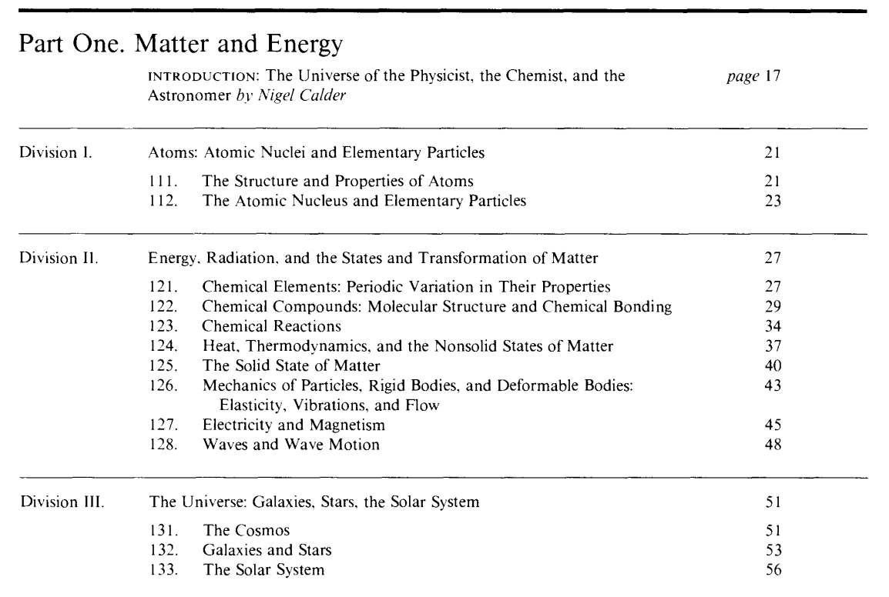

<!-- gid:20250424T142939 -->
[[TIP("이 노트에 대하여")]]
물질과 에너지는 세계를 설명하는 가장 기초적인 두 축이다. 이 메타는 브리태니커 프로피디아의 첫 장을 따라 물리학자, 화학자, 천문학자의 우주를 한 자리에서 조망한다. 우주 이해의 출발점을 잡아 주는 개요 노드다.
[[/TIP]]

<!-- provenance:source:start -->
[[TIP("원본·최신본")]]
이 페이지는 한국어 검색과 읽기를 위한 WikiDocs 미러입니다. [원본·최신본은 가든](https://notes.junghanacs.com/meta/20250424T142939/)에 있습니다. 최신 수정 내용·백링크·태그·히스토리·댓글·출처 정보는 원본 가든에서 확인하세요.

- 작성: `2025-04-24T14:29:00+09:00`
- 최근 수정: `2025-04-24T14:29:00+09:00`
[[/TIP]]
<!-- provenance:source:end -->

[TOC]

## 히스토리

-   [2025-04-24 Thu 14:29]

## 관련메타

-   [1 프로피디아: 지식의개요](https://notes.junghanacs.com/meta/20250420T152816/)
-   [0=53 matter 재료 물질 - 질료](https://notes.junghanacs.com/meta/20250424T230651/)

## KEYWORDS

-   [bib/ 바츨라프스밀 vaclavsmil 에너지 환경 크기 속도 발명 빅픽처논픽션 구루 '2025-04-09 2026-10-08](https://notes.junghanacs.com/bib/20250409T072408/)
-   [bib/ 일론머스크 ElonMusk '2025-05-12 2025-05-12](https://notes.junghanacs.com/bib/20250512T104125/)
-   [notes/ 힣: 낮잠 브레인워시 에너지 회복 '2024-12-07 2025-05-27](https://notes.junghanacs.com/notes/20241207T065515/)

## 1. Matter and Energy 물질 에너지

The lead author was [Nigel Calder](https://en.wikipedia.org/wiki/Nigel_Calder), who wrote the introduction "The Universe of the Physicist, the Chemist, and the Astronomer".

주 저자는 나이젤 칼더였으며, 그는 "물리학자, 화학자, 천문학자의 우주"라는 서문을 썼습니다.

## **1.1** [Atoms](https://en.wikipedia.org/wiki/Atoms)1.1 원자

### **1.1.1**  Structure and Properties of Atoms 1.1.1 원자의 구조와 성질

### **1.1.2**  Atomic Nuclei and Elementary Particles

1.1.2 원자핵과 기본 입자

## **1.2**  Energy, Radiation, and States of Matter

1.2 에너지, 방사선, 물질의 상태

### **1.2.1**  Chemical Elements: Periodic Variation in Their Properties

1.2.1 화학 원소: 주기적 성질 변화

### **1.2.2**  Chemical Compounds: Molecular Structure and Chemical Bonding

1.2.2 화학 화합물: 분자 구조 및 화학 결합

### **1.2.3** [Chemical Reactions](https://en.wikipedia.org/wiki/Chemical_reaction)1.2.3 화학 반응

### **1.2.4**  Heat, Thermodynamics, Liquids, Gases, Plasmas

1.2.4 열, 열역학, 액체, 기체, 플라스마

### **1.2.5**  The Solid State of Matter

1.2.5 물질의 고체 상태

### **1.2.6**  Mechanics of Particles, Rigid and Deformable Bodies: Elasticity, Vibration, and Flow

1.2.6 입자, 강체 및 변형체 역학: 탄성, 진동 및 흐름

### **1.2.7**  Electricity and Magnetism

1.2.7 전기와 자기

### **1.2.8**  Waves and Wave Motion

1.2.8 파동 및 파동 운동

## **1.3** The [Universe](https://en.wikipedia.org/wiki/Universe)1.3 우주

### **1.3.1**  The Cosmos1.3.1 코스모스

### **1.3.2**  Galaxies and Stars1.3.2 은하 및 별

### **1.3.3** The [Solar System](https://en.wikipedia.org/wiki/Solar_System)1.3.3 태양계
